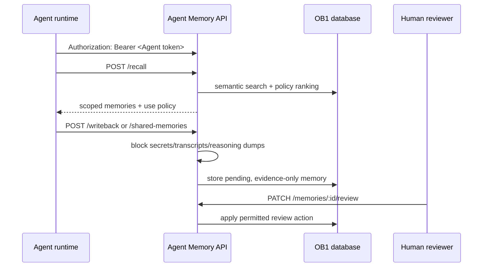

# Agent Memory API

> Runtime-neutral recall, write-back, review, inspection, shared-memory, and trace API for OB1 Agent Memory.



## What It Does

This Edge Function exposes the v1 OB1 Agent Memory contract. OpenClaw is the first launch runtime, but the API is runtime-neutral and can be used by Codex, Claude Code, local agents, n8n, or future adapters. It accesses memory-domain tables only; direct `anon` and `authenticated` table grants remain revoked.

## Prerequisites

- Working Open Brain setup ([guide](../../docs/01-getting-started.md))
- [`schemas/agent-memory`](../../schemas/agent-memory/) applied
- Supabase CLI installed for manual deployment
- `OPENROUTER_API_KEY` and `AGENT_API_CREDENTIALS_JSON` configured as Supabase function secrets
- A unique cryptographically random bearer token per Agent; only each token's SHA-256 digest is stored in the function secret

## Authentication and Trust Boundaries

Every endpoint, including `/health`, requires `Authorization: Bearer <agent-token>`. The API hashes the presented token and maps it to exactly one immutable Agent ID plus an explicit workspace allowlist in `AGENT_API_CREDENTIALS_JSON`; request bodies and other headers cannot choose either value. Every caller-supplied workspace must be in that Agent's allowlist. Personal `agent_memories` are additionally filtered by the server-stamped `metadata.authenticated_agent_id`, while trace access is filtered by the authenticated Agent recorded in `request_payload`. Tokens are never accepted in query parameters or via the legacy `x-brain-key` header. Use a unique token for each Agent and never reuse the shared `MCP_ACCESS_KEY`.

Generate a fresh 32-byte token and its SHA-256 digest in a trusted environment. Store the raw token only in that Agent's secret-backed connector/runtime setting, and store only the digest plus that Agent's explicit allowed workspaces in Supabase. Do not commit either value. The function secret has this shape (replace every placeholder with the intended immutable Agent ID, digest, and workspace IDs):

```json
{
  "<immutable-agent-id>": {
    "token_sha256": "<64-character-sha256-hex-digest>",
    "workspace_ids": ["<authorized-workspace-id>"]
  }
}
```

Personal records or traces without a matching authenticated-Agent attribution are intentionally invisible through these routes; legacy rows are not automatically assigned to an Agent. Backfill ownership only after verifying it from a trusted source.

Agent write-backs and shared-memory writes remain pending and require user review. Caller-supplied `imported` or `user_confirmed` provenance cannot elevate an Agent write. Agent credentials cannot confirm, edit, promote to evidence-only, or widen memory scope; they may only reject, mark stale, or dispute their own records. The API assigns the authenticated Agent ID to new records and review actions server-side.

## Credential Tracker

```text
AGENT MEMORY API -- CREDENTIAL TRACKER
--------------------------------------

FROM YOUR OPEN BRAIN SETUP
  Supabase Project ref:       ____________
  Immutable Agent ID:         ____________
  Per-Agent bearer token:     ____________

GENERATED DURING SETUP
  Agent Memory API URL:       ____________
  Token SHA-256 digest:       ____________

--------------------------------------
```

## Deployment

Apply [`schemas/agent-memory/schema.sql`](../../schemas/agent-memory/schema.sql) and [`schemas/agent-memory/shared-memories.sql`](../../schemas/agent-memory/shared-memories.sql), then configure `AGENT_API_CREDENTIALS_JSON` with the per-Agent token digest and workspace allowlist map above. Supabase Edge Functions provide `SUPABASE_URL` and `SUPABASE_SERVICE_ROLE_KEY` automatically; configure `OPENROUTER_API_KEY` for embedding-based recall/write-back.

Copy this folder into your Supabase project and deploy with custom authentication enabled in the function body:

```bash
supabase functions new agent-memory-api
cp integrations/agent-memory-api/index.ts supabase/functions/agent-memory-api/index.ts
cp integrations/agent-memory-api/auth.js supabase/functions/agent-memory-api/auth.js
cp integrations/agent-memory-api/deno.json supabase/functions/agent-memory-api/deno.json
supabase functions deploy agent-memory-api --no-verify-jwt
```

`--no-verify-jwt` is intentional because the function enforces per-Agent bearer-token authentication itself. Do not deploy until the Agent credential map, including explicit workspace allowlists, is configured.

Verify the deployment without putting the token in the URL:

```bash
curl "https://YOUR_PROJECT_REF.supabase.co/functions/v1/agent-memory-api/health" \
  -H "Authorization: Bearer $OB1_AGENT_MEMORY_KEY"
```

The response includes `"ok": true`. Missing or invalid credentials receive `401`.

## API Surface

The API accepts the runtime-neutral core schema versions and the OpenClaw launch aliases:

| Contract | Runtime-Neutral | OpenClaw Alias |
| -------- | --------------- | -------------- |
| Recall request | `openbrain.agent_memory.recall.v1` | `openbrain.openclaw.recall.v1` |
| Recall response | `openbrain.agent_memory.recall_response.v1` | `openbrain.openclaw.recall_response.v1` |
| Write-back request | `openbrain.agent_memory.writeback.v1` | `openbrain.openclaw.writeback.v1` |
| Write-back response | `openbrain.agent_memory.writeback_response.v1` | `openbrain.openclaw.writeback_response.v1` |

| Endpoint | Method | Purpose |
| --- | --- | --- |
| `/health` | GET | Verify authenticated deployment |
| `/recall` | POST | Retrieve only this Agent's memories from one of its allowed workspaces |
| `/writeback` | POST | Save compact operational memory after work finishes |
| `/recall/:request_id/usage` | POST | Report usage only for owned memories in this Agent's own trace |
| `/memories` | GET | List only this Agent's memories in an allowed workspace, with optional project/status/runtime/type/task filters |
| `/memories/review` | GET | List only this Agent's pending memories in an allowed workspace |
| `/memories/:id` | GET | Inspect only this Agent's record and its source/artifact details |
| `/memories/:id/review` | PATCH | Let an Agent reject, mark stale, or dispute its own writes; other review actions require a user |
| `/recall-traces/:request_id` | GET | Inspect only this Agent's trace and owned memory items |
| `/shared-memories` | GET, POST | Read or write intentionally shared memories, limited to this Agent's allowed workspaces |

`GET /shared-memories` requires `workspace_id`. Project-scoped reads also require `project_id`; workspace and organization reads omit it. Results include active confirmed/evidence-only memories by default. Use `include_unconfirmed=true` to include pending entries for review. `POST /shared-memories` accepts a memory type, summary, content, and sharing scope; project scope requires `project_id`. The server sets `created_by_agent`, keeps new entries pending, and never makes Agent-written entries instruction-grade.

## Expected Outcome

An authenticated Agent can recall relevant context, write back compact memories, and leave a trace that explains what happened. Unsafe write-backs are blocked before durable storage; shared memories are explicitly scoped and remain pending until reviewed.

The trust model is documented in [Safe Agent Memory and Provenance](../../docs/safe-agent-memory-provenance.md).

## Smoke Harness

Use the live smoke harness after deploying the Edge Function and configuring the per-Agent token digest/workspace map. Its denied-workspace test uses `OB1_AGENT_MEMORY_DENIED_WORKSPACE_ID` or a derived workspace ID that must not be in the Agent's allowlist:

```bash
OB1_AGENT_MEMORY_ENDPOINT="https://YOUR_PROJECT_REF.supabase.co/functions/v1/agent-memory-api" \
OB1_AGENT_MEMORY_KEY="YOUR_PER_AGENT_BEARER_TOKEN" \
OB1_AGENT_MEMORY_WORKSPACE_ID="ob1-staging" \
OB1_AGENT_MEMORY_PROJECT_ID="agent-memory-api-smoke" \
OB1_AGENT_MEMORY_DENIED_WORKSPACE_ID="ob1-not-authorized" \
node integrations/agent-memory-api/smoke/live-smoke.mjs
```

The harness checks anonymous and legacy-key rejection, authenticated health, cross-workspace denial for personal/shared reads and recall/write-back, shared-memory scope validation, enforcement of pending status against a forged import claim, conservative recall gating, include-unconfirmed recall, usage reporting, Agent-review denial, memory inspection, recall trace, and unsafe write-back blocking. The unit suite separately exercises cross-Agent and cross-workspace record/trace ownership. It prints a JSON summary and never prints the token.

For personal databases, use the cleanup harness to find or reject smoke/test memories without deleting rows:

```bash
OB1_AGENT_MEMORY_ENDPOINT="https://YOUR_PROJECT_REF.supabase.co/functions/v1/agent-memory-api" \
OB1_AGENT_MEMORY_KEY="YOUR_PER_AGENT_BEARER_TOKEN" \
OB1_AGENT_MEMORY_WORKSPACE_ID="ob1-staging" \
OB1_AGENT_MEMORY_TEST_PROJECT_IDS="agent-memory-api-smoke,agent-memory-openclaw-smoke" \
node integrations/agent-memory-api/smoke/cleanup-test-memory.mjs
```

The default mode is dry-run. Add `--apply` to mark matching active test memories as `rejected`. The harness refuses project IDs that do not look like smoke/test/sandbox scopes.

## Troubleshooting

**Issue: `Invalid or missing Agent bearer token`**

Solution: Send the Agent's unique token in `Authorization: Bearer ...`, confirm its SHA-256 digest maps to that immutable Agent ID in `AGENT_API_CREDENTIALS_JSON`, and ensure the token is not sent in a URL or legacy header.

**Issue: `workspace_id is not authorized for this Agent`**

Solution: Confirm the exact workspace ID is present in that Agent's `workspace_ids` list. Do not work around a denial by widening the request or using another Agent's credentials.

**Issue: recall returns no memories**

Solution: Confirm write-back has created an Agent-attributed `agent_memories` row in an allowlisted workspace, and that the memory is confirmed or `include_unconfirmed` is true. Legacy rows without verified Agent attribution are deliberately excluded.

**Issue: write-back blocked as unsafe**

Solution: Store a compact summary and artifact links. Do not submit raw transcripts, reasoning traces, secrets, or large code blocks.

## Tool Surface Area

This integration exposes an API that plugins can wrap as tools. See the [MCP Tool Audit & Optimization Guide](../../docs/05-tool-audit.md) before adding additional runtime-specific tool surfaces.
