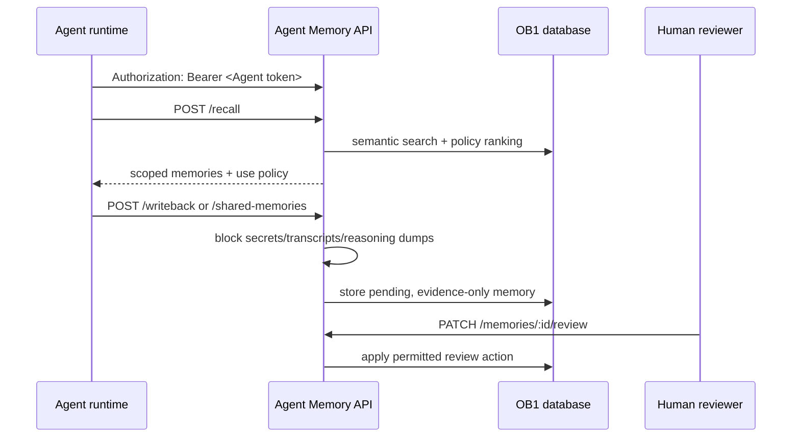

# Agent Memory API

> Runtime-neutral recall, write-back, review, inspection, shared-memory, and trace API for OB1 Agent Memory.



## What It Does

This Edge Function exposes the v1 OB1 Agent Memory contract. OpenClaw is the first launch runtime, but the API is runtime-neutral and can be used by Codex, Claude Code, local agents, n8n, or future adapters. It accesses memory-domain tables only; direct `anon` and `authenticated` table grants remain revoked.

## Prerequisites

- Working Open Brain setup ([guide](../../docs/01-getting-started.md))
- [`schemas/agent-memory`](../../schemas/agent-memory/) applied
- Supabase CLI installed for manual deployment
- `OPENROUTER_API_KEY` and `AGENT_API_KEY_HASHES_JSON` configured as Supabase function secrets
- A unique cryptographically random bearer token per Agent; only each token's SHA-256 digest is stored in the function secret

## Authentication and Trust Boundaries

Every endpoint, including `/health`, requires `Authorization: Bearer <agent-token>`. The API hashes the presented token and maps it to exactly one immutable Agent ID in `AGENT_API_KEY_HASHES_JSON`; request bodies and other headers cannot choose the Agent identity. Tokens are never accepted in query parameters or via the legacy `x-brain-key` header. Use a unique token for each Agent and never reuse the shared `MCP_ACCESS_KEY`.

Generate a fresh 32-byte token and its SHA-256 digest in a trusted environment. Store the raw token only in that Agent's secret-backed connector/runtime setting, and store only the digest in Supabase. Do not commit either value. The function secret has this shape (replace both placeholders):

```json
{"<immutable-agent-id>": "<64-character-sha256-hex-digest>"}
```

Agent write-backs and shared-memory writes remain pending and require user review. Caller-supplied `imported` or `user_confirmed` provenance cannot elevate an Agent write. Agent credentials cannot confirm, edit, promote to evidence-only, or widen memory scope; they may only reject, mark stale, or dispute their own records. The API assigns the authenticated Agent ID to new records and review actions server-side.

## Credential Tracker

```text
AGENT MEMORY API -- CREDENTIAL TRACKER
--------------------------------------

FROM YOUR OPEN BRAIN SETUP
  Supabase Project ref:       ____________
  Immutable Agent ID:         ____________
  Per-Agent bearer token:     ____________

GENERATED DURING SETUP
  Agent Memory API URL:       ____________
  Token SHA-256 digest:       ____________

--------------------------------------
```

## Deployment

Apply [`schemas/agent-memory/schema.sql`](../../schemas/agent-memory/schema.sql) and [`schemas/agent-memory/shared-memories.sql`](../../schemas/agent-memory/shared-memories.sql), then configure `AGENT_API_KEY_HASHES_JSON` with the Agent ID-to-digest map above. Supabase Edge Functions provide `SUPABASE_URL` and `SUPABASE_SERVICE_ROLE_KEY` automatically; configure `OPENROUTER_API_KEY` for embedding-based recall/write-back.

Copy this folder into your Supabase project and deploy with custom authentication enabled in the function body:

```bash
supabase functions new agent-memory-api
cp integrations/agent-memory-api/index.ts supabase/functions/agent-memory-api/index.ts
cp integrations/agent-memory-api/auth.js supabase/functions/agent-memory-api/auth.js
cp integrations/agent-memory-api/deno.json supabase/functions/agent-memory-api/deno.json
supabase functions deploy agent-memory-api --no-verify-jwt
```

`--no-verify-jwt` is intentional because the function enforces per-Agent bearer-token authentication itself. Do not deploy until the Agent token digest map is configured.

Verify the deployment without putting the token in the URL:

```bash
curl "https://YOUR_PROJECT_REF.supabase.co/functions/v1/agent-memory-api/health" \
  -H "Authorization: Bearer $OB1_AGENT_MEMORY_KEY"
```

The response includes `"ok": true`. Missing or invalid credentials receive `401`.

## API Surface

The API accepts the runtime-neutral core schema versions and the OpenClaw launch aliases:

| Contract | Runtime-Neutral | OpenClaw Alias |
| -------- | --------------- | -------------- |
| Recall request | `openbrain.agent_memory.recall.v1` | `openbrain.openclaw.recall.v1` |
| Recall response | `openbrain.agent_memory.recall_response.v1` | `openbrain.openclaw.recall_response.v1` |
| Write-back request | `openbrain.agent_memory.writeback.v1` | `openbrain.openclaw.writeback.v1` |
| Write-back response | `openbrain.agent_memory.writeback_response.v1` | `openbrain.openclaw.writeback_response.v1` |

| Endpoint | Method | Purpose |
| --- | --- | --- |
| `/health` | GET | Verify authenticated deployment |
| `/recall` | POST | Retrieve scoped memories before work starts |
| `/writeback` | POST | Save compact operational memory after work finishes |
| `/recall/:request_id/usage` | POST | Report which recalled memories were used or ignored |
| `/memories` | GET | List memories by workspace, project, status, runtime, type, or task prefix |
| `/memories/review` | GET | List pending agent-written memories |
| `/memories/:id` | GET | Inspect one memory with source/artifact details |
| `/memories/:id/review` | PATCH | Let an Agent reject, mark stale, or dispute its own writes; other review actions require a user |
| `/recall-traces/:request_id` | GET | Debug what was recalled and how it was used |
| `/shared-memories` | GET, POST | Read or write shared workspace-, project-, or organization-scoped memories |

`GET /shared-memories` requires `workspace_id`. Project-scoped reads also require `project_id`; workspace and organization reads omit it. Results include active confirmed/evidence-only memories by default. Use `include_unconfirmed=true` to include pending entries for review. `POST /shared-memories` accepts a memory type, summary, content, and sharing scope; project scope requires `project_id`. The server sets `created_by_agent`, keeps new entries pending, and never makes Agent-written entries instruction-grade.

## Expected Outcome

An authenticated Agent can recall relevant context, write back compact memories, and leave a trace that explains what happened. Unsafe write-backs are blocked before durable storage; shared memories are explicitly scoped and remain pending until reviewed.

The trust model is documented in [Safe Agent Memory and Provenance](../../docs/safe-agent-memory-provenance.md).

## Smoke Harness

Use the live smoke harness after deploying the Edge Function and configuring the per-Agent token hash:

```bash
OB1_AGENT_MEMORY_ENDPOINT="https://YOUR_PROJECT_REF.supabase.co/functions/v1/agent-memory-api" \
OB1_AGENT_MEMORY_KEY="YOUR_PER_AGENT_BEARER_TOKEN" \
OB1_AGENT_MEMORY_WORKSPACE_ID="ob1-staging" \
OB1_AGENT_MEMORY_PROJECT_ID="agent-memory-api-smoke" \
node integrations/agent-memory-api/smoke/live-smoke.mjs
```

The harness checks anonymous and legacy-key rejection, authenticated health, shared-memory scope validation, enforcement of pending status against a forged import claim, conservative recall gating, include-unconfirmed recall, usage reporting, Agent-review denial, memory inspection, recall trace, and unsafe write-back blocking. It prints a JSON summary and never prints the token.

For personal databases, use the cleanup harness to find or reject smoke/test memories without deleting rows:

```bash
OB1_AGENT_MEMORY_ENDPOINT="https://YOUR_PROJECT_REF.supabase.co/functions/v1/agent-memory-api" \
OB1_AGENT_MEMORY_KEY="YOUR_PER_AGENT_BEARER_TOKEN" \
OB1_AGENT_MEMORY_WORKSPACE_ID="ob1-staging" \
OB1_AGENT_MEMORY_TEST_PROJECT_IDS="agent-memory-api-smoke,agent-memory-openclaw-smoke" \
node integrations/agent-memory-api/smoke/cleanup-test-memory.mjs
```

The default mode is dry-run. Add `--apply` to mark matching active test memories as `rejected`. The harness refuses project IDs that do not look like smoke/test/sandbox scopes.

## Troubleshooting

**Issue: `Invalid or missing Agent bearer token`**

Solution: Send the Agent's unique token in `Authorization: Bearer ...`, confirm its SHA-256 digest maps to that immutable Agent ID in `AGENT_API_KEY_HASHES_JSON`, and ensure the token is not sent in a URL or legacy header.

**Issue: recall returns no memories**

Solution: Confirm write-back has created `agent_memories`, and that those memories are confirmed or `include_unconfirmed` is true.

**Issue: write-back blocked as unsafe**

Solution: Store a compact summary and artifact links. Do not submit raw transcripts, reasoning traces, secrets, or large code blocks.

## Tool Surface Area

This integration exposes an API that plugins can wrap as tools. See the [MCP Tool Audit & Optimization Guide](../../docs/05-tool-audit.md) before adding additional runtime-specific tool surfaces.
