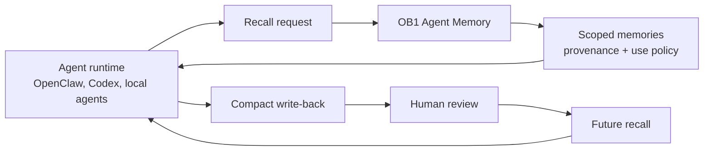

# Agent Memory

> Governed operational memory for agent runtimes, with provenance, review, recall traces, and audit trails.



## What It Does

This schema adds sidecar tables that let Open Brain store agent-created operational memory safely. The core `thoughts` table remains the content store; agent memory records add provenance, confidence, scope, use policy, review status, source references, recall traces, and audit events.

## Prerequisites

- Working Open Brain setup ([guide](../../docs/01-getting-started.md))
- Supabase project with the core `thoughts` table
- The core dedupe setup from Step 2.6 is recommended

## Credential Tracker

```text
AGENT MEMORY -- CREDENTIAL TRACKER
--------------------------------------

SUPABASE (from your Open Brain setup)
  Project URL:           ____________
  Secret key:            ____________

--------------------------------------
```

## Steps


Open Supabase SQL Editor, paste and run [`schema.sql`](./schema.sql), [`shared-memories.sql`](./shared-memories.sql), and [`api-credentials.sql`](./api-credentials.sql).

**Done when:** Table Editor shows the core `agent_memories` and trace/audit tables, `shared_agent_memories`, and `agent_api_credentials`.


Run this query:

```sql
SELECT column_name, column_default
FROM information_schema.columns
WHERE table_name = 'agent_memories'
  AND column_name IN (
    'can_use_as_instruction',
    'can_use_as_evidence',
    'requires_user_confirmation',
    'review_status'
  );
```

Also verify the shared table grants and RLS flag:

```sql
SELECT grantee, privilege_type
FROM information_schema.role_table_grants
WHERE table_schema = 'public'
  AND table_name = 'shared_agent_memories'
  AND grantee IN ('anon', 'authenticated', 'service_role')
ORDER BY grantee, privilege_type;

SELECT c.relname, c.relrowsecurity
FROM pg_class c
JOIN pg_namespace n ON n.oid = c.relnamespace
WHERE n.nspname = 'public' AND c.relname IN ('shared_agent_memories', 'agent_api_credentials')
ORDER BY c.relname;

SELECT grantee, privilege_type
FROM information_schema.role_table_grants
WHERE table_schema = 'public'
  AND table_name = 'agent_api_credentials'
  AND grantee IN ('anon', 'authenticated', 'service_role')
ORDER BY grantee, privilege_type;
```

**Done when:** memory instruction defaults to `false`, evidence defaults to `true`, confirmation defaults to `true`, review defaults to `pending`, and both `shared_agent_memories` and `agent_api_credentials` grant no access to `anon` or `authenticated`; the credential registry grants `SELECT` only to `service_role` with RLS enabled.


Before deploying the runtime API from [`../../integrations/agent-memory-api/`](../../integrations/agent-memory-api/), securely provision an enabled `agent_api_credentials` row containing the SHA-256 digest, immutable Agent ID, and exact allowed workspace IDs. The raw bearer token belongs only in that Agent's secret-backed connector/runtime setting; it is never stored in Supabase. No additional Edge Function secret is required for Agent authentication.

**Done when:** `GET /health` on the deployed API returns `{"ok":true}` for the configured Agent and an invalid token receives `401`.

## Expected Outcome

After applying all three schema files, OB1 can store agent memories and explicitly scoped shared memories as governed records instead of raw transcript dumps. Agent-written memories start pending and evidence-only; only `user_confirmed` or trusted `imported` memories can become instruction-grade.

Use [Safe Agent Memory and Provenance](../../docs/safe-agent-memory-provenance.md) as the operating guide for provenance, review status, use policy, and scope decisions.

## Troubleshooting

**Issue: `agent-memory requires public.thoughts`**
Solution: Run the core Open Brain setup first.

**Issue: instruction-grade write fails**
Solution: This is usually correct. `can_use_as_instruction` is only allowed for `user_confirmed` or `imported` memory.

**Issue: API cannot read tables**
Solution: Re-run the GRANT section at the bottom of `schema.sql` and verify `service_role` has `SELECT` on `agent_api_credentials`; redeploy the Edge Function so PostgREST reloads the schema cache.
